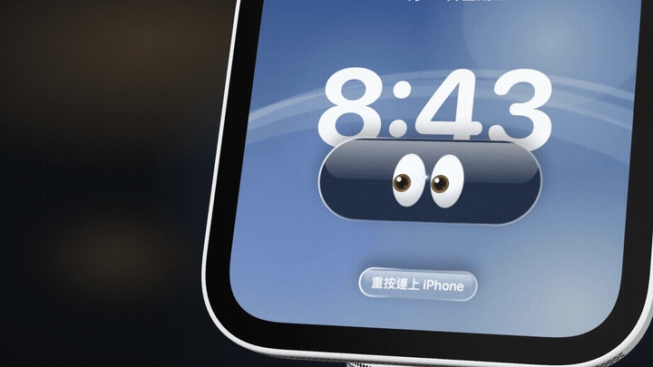
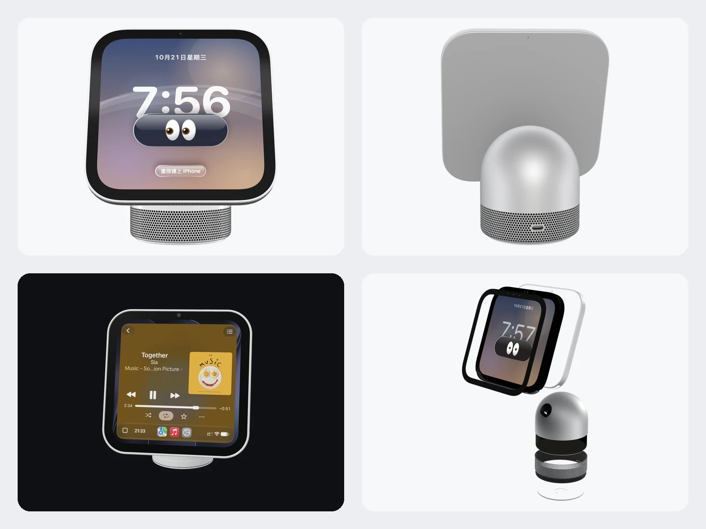
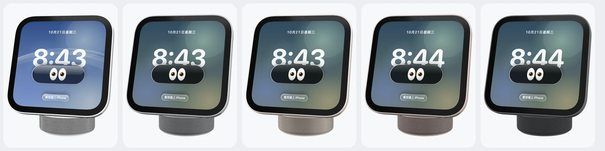
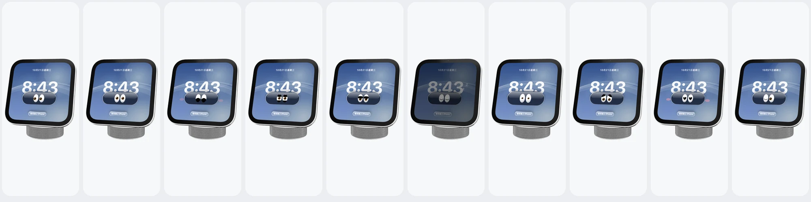
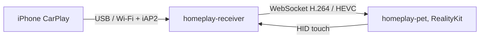

<div align="center">
  
  <h1>HomePlay</h1>
  <p><strong>A tiny 3D HomeView on your Mac desktop, with real CarPlay.</strong></p>
  <p><a href="README.md">简体中文</a> · <a href="https://homeplay.aaronlau.me">Website</a> · <a href="https://homeplay.aaronlau.me/en/">English site</a></p>
  <p>
    <a href="https://github.com/surfine/HomePlay/releases/latest"></a>
    
    
    
    
  </p>
</div>

> Experimental personal project. Not affiliated with, endorsed by, or certified by Apple. CarPlay and HomeView are trademarks of Apple Inc. Use at your own risk.

## Install

**Requirements:** macOS 14 or later, Apple Silicon.

[**Download HomePlay-macOS-arm64.zip**](https://github.com/surfine/HomePlay/releases/latest/download/HomePlay-macOS-arm64.zip) (about 10.5 MB), then:

1. Unzip and drag `HomePlay.app` into Applications.
2. Open it. The desk pet appears with its clock and eyes. No account, profile, or setup.
3. For CarPlay, connect an iPhone over USB once and accept Trust and Pair on the iPhone.
4. Press and hold the pet to enter CarPlay. Unplugging switches to wireless after the first pairing.

The release is Developer ID signed and notarized by Apple, so Gatekeeper opens it after unzipping. The matching checksum is [`HomePlay-macOS-arm64.zip.sha256`](https://github.com/surfine/HomePlay/releases/latest/download/HomePlay-macOS-arm64.zip.sha256). Verify with `shasum -a 256 -c HomePlay-macOS-arm64.zip.sha256`.

## What's new in 0.5.0

- **First public release** of the current app.
- **One pair of eyes**: the website and the device now share the amber 👀 language, and blink, asleep, and wink use a Donald-style lower lid with the white sclera kept.
- **Refreshed media**: three-language renders, new share cards, and a textless Mark View-style hero film on the website.

[Full release notes](https://github.com/surfine/HomePlay/releases/tag/v0.5.0)

## Screenshots



| Five finishes | Ten faces |
|:---:|:---:|
|  |  |

## Features

- **Real CarPlay**: wireless (Bluetooth iAP2 to Wi-Fi) or wired USB, H.264 and HEVC video, touch sent back to the iPhone, sound through the Mac, and Now Playing in Control Center.
- **Pair once, then wireless**: the first pairing is over USB; after it settles the session moves to Wi-Fi and unplugging does not end it. When two iPhones are connected, the later one gets the single CarPlay session.
- **Built from the official product**: Apple's HomeView USDZ geometry and materials, five finishes, a nine-part exploded view, a back USB-C port, and RealityKit IBL at Quick Look quality.
- **A desk pet that looks back**: ten expressions, nine faces, drag and two-finger gestures, three-finger move, pinch, force press, and long press. The optional Follow Me and Room Light features use the camera only while enabled.
- **Quiet and power-aware**: idle turns into a static poster and the ARView leaves the window; occlusion and display sleep stop rendering. No notifications, no feedback, no telemetry.
- **Zero setup**: the receiver finds the current Wi-Fi and matches the phone; pairing and unplugging switch automatically. No Keychain access and no admin password.
- **Public-facing**: one instance, VoiceOver labels, English, Simplified Chinese and Traditional Chinese, localized permission strings, GPL source.

## How it works



## Gestures

<details>
<summary>All gestures</summary>

| Gesture | Result |
|---|---|
| Drag, or two-finger swipe | Turn the body |
| Three-finger drag, or ⌘ drag | Move it (drag the frame while streaming) |
| Pinch, ⌘+, ⌘−, ⌘0 | Zoom (⌘0 resets) |
| Press firmly | Enter or leave CarPlay |
| Long press the screen | Change the face |
| Double-click | Reset the angle |
| Two-finger double tap | Take it apart or put it back |
| ⌘H | Hide the pet (the menu bar icon brings it back) |

</details>

## Privacy and permissions

HomePlay talks to no server. There is no account and no telemetry. Permissions are requested one feature at a time:

| Permission | When it is asked | If denied |
|---|---|---|
| Camera | When Follow Me or Room Light is enabled | The pet works normally |
| Microphone | The first CarPlay call or Siri request | The CarPlay screen and touch still work |
| Bluetooth | The first iPhone pairing | USB still works |
| Local Network | Receiving the CarPlay picture | CarPlay cannot connect |
| Calendar | When the calendar face is enabled | Other faces still work |
| Automation | When Mac Now Playing is enabled | Other features still work |

Camera frames are processed on this Mac, never saved and never uploaded. If wireless CarPlay needs Wi-Fi credentials, the user enters them once in the menu and they are stored in a local 0600 file. The system Keychain is not read.

## Build from source

You need macOS 14 or later and the Swift 6 toolchain.

The public source snapshot does **not** include Apple's HomeView USDZ. Add `apple-homeview.usdz` to `Sources/homeplay-pet/Resources/`, or the pet body will not load. The signed release already includes it.

```sh
swift build -c release
B=.build/release

$B/homeplay-receiver --source auto --ssid '<Wi-Fi name>' --port 8788
$B/homeplay-pet --endpoint ws://127.0.0.1:8788

$B/session-tests && $B/iap2-offline-tests
```

For CarPlay from source, supply `identity.pk8` and `certificate.p7b` with `--identity-dir <dir>` or `HOMEPLAY_IDENTITY_DIR`. Only the pet, or `--source window` / `h264`, does not need an identity. The source does not print or upload identity material.

| Target | What it is |
|---|---|
| `homeplay-pet` | The 3D pet: RealityKit + Apple USDZ, live receiver picture, touch back |
| `homeplay-receiver` | Receiver: `auto` (USB or wireless), `wireless`, `usb`, `window`, `h264` |
| `homeplay-verify` | Acts as a client and decodes one frame to PNG |
| `session-tests` / `iap2-offline-tests` | Offline session and iAP2 tests |

## Docs

| Doc | What is inside |
|---|---|
| [Wireless pairing](docs/wireless.md) | The iAP2 handshake, the optional Wi-Fi credential, and troubleshooting |
| [Performance](docs/performance.md) | The render loop, idle behavior, and power measurements |
| [Room light](docs/room-light.md) | The optional camera-based lighting estimate |
| [HomeView study](docs/homeview-study.md) | Proportions and the official USDZ structure |
| [CarPlay notes](docs/carplay-best-practices.md) | Receiver implementation notes and edge cases |

Historical renders and design drafts live in [`docs/evidence/`](docs/evidence/) and [`docs/design-drafts/`](docs/design-drafts/). They are historical, not current product screenshots.

## Identity (source builds only)

The signed release bundles a public experimental accessory identity, so CarPlay works out of the box and the user does not need to prepare any identity file. The public source snapshot does not include that identity. If you build from source and want CarPlay, provide your own `identity.pk8` and `certificate.p7b`; legality and provenance are your responsibility. The tools never print identity contents.

## Credits and license

GPL-3.0-or-later, see [`LICENSE`](LICENSE). The CarPlay session control plane was reimplemented in Swift after studying MacPlay and LIVI behavior; credits and copyright notices are in [`NOTICE`](NOTICE).

HomePlay is a personal experiment and is not affiliated with Apple Inc. CarPlay and HomeView are trademarks of Apple Inc. and are used here only to describe compatibility.

This repository is a curated snapshot synced from a private development repository, so its history is one sync commit at a time.

## Feedback

Open an [issue](https://github.com/surfine/HomePlay/issues). There is no support SLA, but reproducible reports are read.
