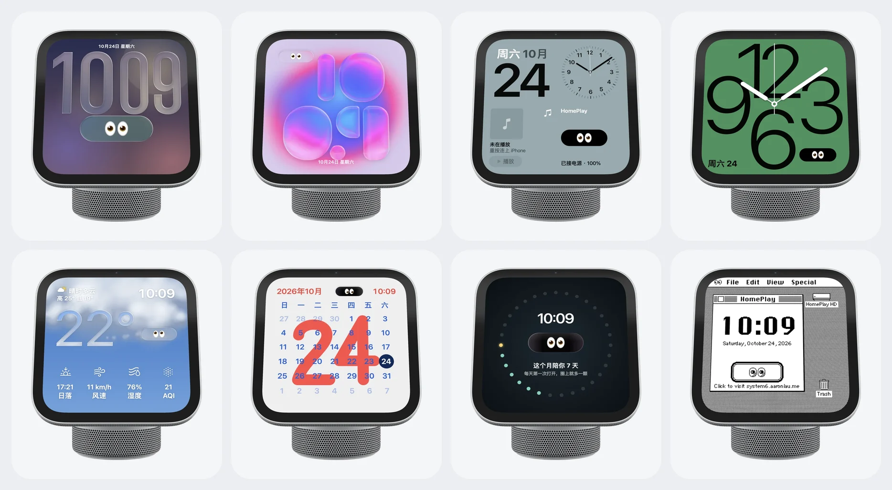

<div align="center">
  
  <h1>HomePlay</h1>
  <p><strong>It watches you, and brings CarPlay to your Mac.</strong></p>
  <p>HomeView, made into a desk pet for your Mac: try the HomeView software before the hardware ships.</p>
  <p><a href="README.md">简体中文</a> · <a href="https://homeplay.aaronlau.me/en/">Website</a></p>
  <p>
    <a href="https://github.com/surfine/HomePlay/releases/latest"></a>
    
    
    
    
  </p>
</div>

> Experimental personal project. Not affiliated with, endorsed by, or certified by Apple. CarPlay and HomeView are trademarks of Apple Inc. Use at your own risk.

## What it is

A HomeView that lives on your Mac’s desktop. It has a pair of eyes that watch you, and one firm press turns it into your iPhone’s CarPlay.

- **It watches you.** One pair of 👀, ten expressions. Come closer and it looks over, curious. Rest your pointer on it and it smiles. Leave it alone late at night and it dozes off. The eyes live in a capsule that matches the face’s era: solid black, smoked, or Liquid Glass.
- **13 faces.** Laid out like Apple’s HomeView faces: Island, Photos, Modular, Typograph, Flow, Weather, Calendar, Embossed Hands, Days Together, Black, plus three System 6 throwbacks. The big time is the system’s own Liquid Glass, and you can pick its font and color the way you do on the iOS 27 Lock Screen.
- **Press firmly for CarPlay.** Plug in once, then it’s wireless. Your iPhone sends real CarPlay video and sound to the little screen, and tapping it works like tapping the screen in a car. Hold F5 to talk to your iPhone’s Siri.
- **Handy extras.** Focus timer, Now Playing, battery and your next event. F7–F9 skip tracks, and the window can float on top like a mini player for your iPhone’s library.


| 13 faces | Ten expressions |
|:---:|:---:|
|  |  |

## First time: three steps

**Requires** macOS 14 or later on Apple silicon.

1. [**Download HomePlay-macOS-arm64.zip**](https://github.com/surfine/HomePlay/releases/latest/download/HomePlay-macOS-arm64.zip), unzip, drag `HomePlay.app` into Applications and open it.
2. Connect your iPhone to the Mac with a cable once, then tap Trust and Pair on the iPhone.
3. Press firmly on the pet’s screen to enter CarPlay. After that you can unplug, and it reconnects wirelessly on its own.

The app is signed with a Developer ID and notarized by Apple, so it opens straight away. To check the download: [`HomePlay-macOS-arm64.zip.sha256`](https://github.com/surfine/HomePlay/releases/latest/download/HomePlay-macOS-arm64.zip.sha256), `shasum -a 256 -c HomePlay-macOS-arm64.zip.sha256`.

**Tested so far on two iPhones only:** an iPhone SE (1st generation, Lightning) on iOS 15 and an iPhone 18 Pro (USB-C) on iOS 27. Reports from other models are welcome.

## How to use it

| To… | Do this |
|---|---|
| Enter or leave CarPlay | Press firmly on the screen (Force Click) |
| Talk to Siri | Hold F5 |
| Change faces | Scroll or press ← →; press and hold the screen to see them all |
| Turn it | Drag or two-finger swipe on the body; double-click to face front |
| Zoom | Pinch, ⌥-scroll, or ⌘+ ⌘− ⌘0 |
| Move it | Three-finger drag, or ⌘-drag |
| Take it apart | Double-tap with two fingers |
| Settings | Right-click, or ⌘, |

## 🧑🏻‍💻 From the developer

> 👀 is one of my favorite emoji, for excitement and anticipation. Donald Duck is one of my favorite cartoon characters too: big lively eyes, a bit goofy, adorable.
>
> I believe that in the age of AI, staying curious, freeing your imagination, being creative, keeping your judgment and learning to work together matter more than ever. I hope this little desk pet brings you some fun.

## Coming in 0.7.0

These are done and waiting on real-device testing of wireless CarPlay; they ship as soon as that passes.

- **Eyes on every face.** The capsule follows each face’s era: solid black on the flat layouts, smoked on the iOS 27 ones, Liquid Glass on HomeView’s own, and a 1-bit button on System 6.
- **New faces:** Weather, Calendar, Embossed Hands, Black, and three System 6 faces rebuilt the way they looked in 1988 (Chicago type, 1-bit pixels).
- **A Siri orb for F5.** While you talk, a colorful Siri orb rises on the screen; let go and it shrinks back.
- **Type and corners closer to Apple’s.** The time uses SF Pro’s variable weight, width and optical size, and the capsule, cards and body corners stay concentric.
- **No more ghosting when faces change,** and it sips less power while idle.

## Privacy and permissions

There is no account and no telemetry. The only thing that goes online on its own is the Weather face, which sends your approximate location to Open-Meteo to look up local weather. Permissions are requested one feature at a time:

| Permission | When it is asked | If denied |
|---|---|---|
| Camera | When Follow Me or Room Light is enabled | The pet works normally |
| Microphone | The first CarPlay call or Siri request | The CarPlay screen and touch still work |
| Bluetooth | The first iPhone pairing | USB still works |
| Local Network | Receiving the CarPlay picture | CarPlay cannot connect |
| Location (approximate) | The first time the Weather face appears | Weather shows the last known city, or no weather |
| Calendar | When the calendar face is enabled | Other faces still work |
| Automation | When Mac Now Playing is enabled | Other features still work |

Camera frames are processed on this Mac, never saved and never uploaded. If wireless CarPlay needs Wi-Fi credentials, the user enters them once in the menu and they are stored in a local 0600 file. The system Keychain is not read.

## Build from source

You need macOS 14 or later and the Swift 6 toolchain.

The public source snapshot does **not** include Apple's HomeView USDZ. Add `apple-homeview.usdz` to `Sources/homeplay-pet/Resources/`, or the pet body will not load. The signed release already includes it.

```sh
swift build -c release
B=.build/release

$B/homeplay-receiver --source auto --ssid '<Wi-Fi name>' --port 8788
$B/homeplay-pet --endpoint ws://127.0.0.1:8788

$B/session-tests && $B/iap2-offline-tests
```

For CarPlay from source, supply `identity.pk8` and `certificate.p7b` with `--identity-dir <dir>` or `HOMEPLAY_IDENTITY_DIR`. Only the pet, or `--source window` / `h264`, does not need an identity. The source does not print or upload identity material.

| Target | What it is |
|---|---|
| `homeplay-pet` | The 3D pet: RealityKit + Apple USDZ, live receiver picture, touch back |
| `homeplay-receiver` | Receiver: `auto` (USB or wireless), `wireless`, `usb`, `window`, `h264` |
| `homeplay-verify` | Acts as a client and decodes one frame to PNG |
| `session-tests` / `iap2-offline-tests` | Offline session and iAP2 tests |

## Docs

| Doc | What is inside |
|---|---|
| [Wireless pairing](docs/wireless.md) | The iAP2 handshake, the optional Wi-Fi credential, and troubleshooting |
| [Performance](docs/performance.md) | The render loop, idle behavior, and power measurements |
| [Room light](docs/room-light.md) | The optional camera-based lighting estimate |
| [HomeView study](docs/homeview-study.md) | Proportions and the official USDZ structure |
| [CarPlay notes](docs/carplay-best-practices.md) | Receiver implementation notes and edge cases |

Historical renders and design drafts live in [`docs/evidence/`](docs/evidence/) and [`docs/design-drafts/`](docs/design-drafts/). They are historical, not current product screenshots.

## Identity (source builds only)

The signed release bundles a public experimental accessory identity, so CarPlay works out of the box and the user does not need to prepare any identity file. The public source snapshot does not include that identity. If you build from source and want CarPlay, provide your own `identity.pk8` and `certificate.p7b`; legality and provenance are your responsibility. The tools never print identity contents.

## Credits and license

GPL-3.0-or-later, see [`LICENSE`](LICENSE). The CarPlay session control plane was reimplemented in Swift after studying MacPlay and LIVI behavior; credits and copyright notices are in [`NOTICE`](NOTICE).

HomePlay is a personal experiment and is not affiliated with Apple Inc. CarPlay and HomeView are trademarks of Apple Inc. and are used here only to describe compatibility.

This repository is a curated snapshot synced from a private development repository, so its history is one sync commit at a time.

## Feedback

Open an [issue](https://github.com/surfine/HomePlay/issues). There is no support SLA, but reproducible reports are read.
