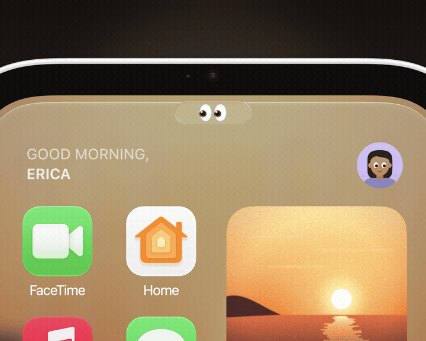
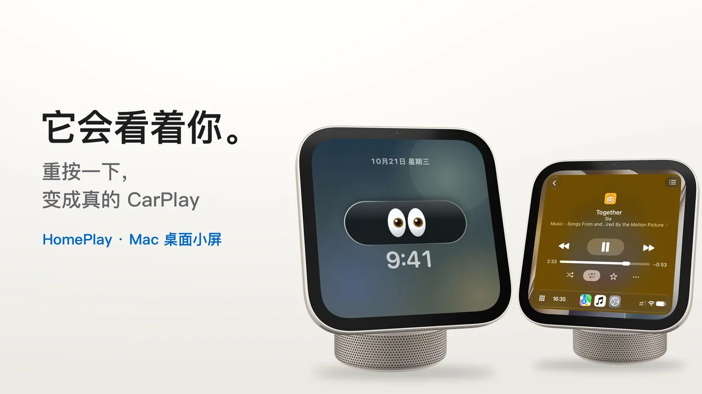

# HomePlay

[简体中文](README.md)
[Website](https://homeplay.aaronlau.me/en/2.0/)
[A history of widgets](https://homeplay.aaronlau.me/en/history/)



A screen that stays on the Mac desktop. Glance, and you can see what you care about. When you want to act, you act there.

The Mac gets a HomeView of its own. The eyes watch you. The Home Screen, the apps, and CarPlay all live in that little machine.

A personal experiment. Not affiliated with, endorsed by, or certified by Apple Inc. CarPlay and HomeView are trademarks of Apple Inc., used here to name what this app can connect to.

[Download 2.0 beta 6](https://github.com/surfine/HomePlay/releases/download/v2.0.0-beta.6/HomePlay-2.0-beta6-macOS-arm64.zip)
[Stable 1.0.6](https://github.com/surfine/HomePlay/releases/download/v1.0.6/HomePlay-macOS-arm64.zip)

macOS 14 or later, Apple silicon. Both builds are Developer ID signed and notarized by Apple. Beta 6 can break. For the stable app, use 1.0.6. GPL-3.0-or-later.

## At the desk

A small machine sits in the corner. It watches you. The next event, the current song, and the time left on a timer are on that screen.

Pull down from the 👀 to go Home. Pull down and hold for the app switcher. Press and hold the 👀, or hold F5, to talk to ClioTalk. Before it sends a message, adds a reminder, or changes an event in your name, it reads the text back. It proceeds when you say yes.

The space bar moves between CarPlay and the Home Screen. On the CarPlay screen, the arrow keys, Tab, and Return work like the knob in a car. CarPlay keeps playing in the background, and the progress stays beside the eyes.

An old iPad or phone can be paired as SideShow, a second display for the clock, weather, now playing, and a timer. Pair it by scanning a code. When the Mac sleeps, the second display keeps the last picture.

<a href="https://www.bilibili.com/video/BV1rTnz6YEmM/"></a>

The 44-second film shows the desk pet and CarPlay. [Watch it on Bilibili](https://www.bilibili.com/video/BV1rTnz6YEmM/). The 2.0 Home Screen is on the [website](https://homeplay.aaronlau.me/en/2.0/).

## Why it takes a space of its own

The Mac already has a desktop, windows, notifications, and widgets. You usually learn that something changed in one of two ways: you open the app, or a notification breaks in.

In 2001 Microsoft Research tried a third way. JJ Cadiz, Gina Venolia, Gavin Jancke, and Anoop Gupta built Sideshow, a place that stays at the edge of your vision. It shows a short summary of what matters to you. Move the pointer over a summary and it opens, ready to act on. When you are done, you return to the work you left.

They wrote up the design and what happened when people inside the company used it: [Designing and Deploying an Information Awareness Interface](https://www.microsoft.com/en-us/research/publication/designing-and-deploying-an-information-awareness-interface-2/) (CSCW 2002). The earlier report is [Sideshow: Providing Peripheral Awareness of Important Information](https://www.microsoft.com/en-us/research/publication/sideshow-providing-peripheral-awareness-of-important-information/) (MSR-TR-2001-83).

HomePlay turns that place into a small machine on the desk. Summaries, apps, and actions share one screen. The Mac desktop, the Dock, and Notification Center stay where they are.

The Sideshow in the paper is a strip of summaries along the screen edge. SideShow in HomePlay is a second display on an old device. The machine on the desk is the one that stays on.

Apple once put widgets in Dashboard, and later brought widgets back to the desktop. That line is told in [A history of widgets](https://homeplay.aaronlau.me/en/history/).

## A simulator is for testing

Xcode’s Simulator is how developers test an interface. HomePlay is an app you leave on the desk. The Home Screen, the apps, ClioTalk, and CarPlay share one machine. The mouse, trackpad, and keyboard all work. On a touch Mac and in Sidecar, a finger can tap, swipe, press, and pinch, and the 👀 follow the finger.

If you only want to see what an operating system looks like, a simulator or a virtual machine is the direct route.

## First launch

1. Download the zip, unzip it, drag `HomePlay.app` into Applications, and open it.
2. The first launch walks through language, permissions, your iPhone, and a look.
3. For CarPlay, connect the iPhone with a cable once and tap Trust and Pair on the phone. You can unplug after that. It moves to Wi-Fi. If the first handoff misses, turn Wi-Fi off and on once in the iPhone Control Center.

CarPlay has been tried on two iPhones so far: an iPhone SE (1st generation, Lightning) on iOS 15, and an iPhone 18 Pro (USB-C) on iOS 27. Reports from other phones are welcome.

## How to use it

| To | In 2.0 beta 6 |
|---|---|
| Go to the Home Screen | Pull down from the 👀 |
| Open the app switcher | Pull down from the 👀 and hold |
| Talk to ClioTalk | Press and hold the 👀, or hold F5 |
| Move between CarPlay and Home | Space bar |
| Move focus in CarPlay | Arrow keys, Tab, Return |
| Change the watch face | Press and hold the screen |
| Open Settings | Right-click, or ⌘, |

The body can turn, resize, and move. Drag or two-finger swipe on the body to turn it. Double-click to face front. Pinch, ⌥-scroll, or ⌘+ ⌘− ⌘0 to zoom. Three-finger drag, or ⌘-drag, to move it. Double-tap with two fingers to take it apart.

In 1.0.6, a firm press on the screen enters CarPlay. Hold F5 to talk to the iPhone’s Siri.

## What beta 6 adds

The full list is in the [release notes](https://github.com/surfine/HomePlay/releases/tag/v2.0.0-beta.6).

- The Home Screen has no Dock. The second page holds CarPlay, Weather, Timers, World Clock, Safari, Recipes, Sing, Games, Contacts, and Find My. The next page is the App Library.
- CarPlay apps from the iPhone show up under iPhone in the App Library. One tap opens one inside CarPlay. Hide them in Settings › Appearance.
- Sing, Games, Contacts, plus a thermostat page and cameras in Home. The thermostat and the cameras need the updated HomePlay Home helper. The public beta does not include that helper yet. Without it, HomePlay says why and opens the Mac’s Home app.
- System widgets on the Mac desktop can sit on the Home Screen, including widgets added from an iPhone.
- Each family member has a Home Screen, a Look, playlists, and reminders. Switch from the avatar, or tell ClioTalk “I’m …”.
- An incoming AirDrop raises a card. Photos, web pages, and recipes can go to the iPhone. While CarPlay is connected, the iPhone blocks AirDrop, so Send to iPhone goes out as a Message to yourself. Receive AirDrop in Control Center pauses CarPlay, then reconnects and leaves you where you were.

ClioTalk uses your own key. An Anthropic or DeepSeek key stays in the Keychain. You can also run a model locally with LM Studio, or use the on-device Apple Intelligence model on macOS 26 or later. The default cap is 5 US dollars a month, and it stops at the cap. Audio stays in memory. An answer is temporary until you keep it.

Recognizing who is looking is off by default. When you turn it on, the face is computed on this Mac. HomePlay stores the numbers that describe the face, and it does not store a photo. Those numbers are general image features. Do not treat them as a biometric lock. Up to six people. Someone it does not recognize, and anyone in guest mode, sees the default Home Screen.

## Limits of this beta

- The full Liquid Glass look, on-device speech, and on-device models need macOS 26 or later.
- Cloud ClioTalk needs your own key.
- FaceTime and Find My are completed by the Mac’s own apps. Intercom plays from the Mac or an AirPlay speaker.
- YouTube videos play audio only. Videos from other sources play normally.
- Messages can be read only after HomePlay has Full Disk Access. Sending uses AppleScript. If delivery is not confirmed, HomePlay says so and does not retry on its own.
- The interface is HomePlay’s own. The CarPlay picture comes from your iPhone.

## From the developer

> 👀 is one of my favorite emoji, for excitement and anticipation. Donald Duck is one of my favorite cartoon characters too: big lively eyes, a bit goofy, adorable.
>
> I believe that in the age of AI, staying curious, freeing your imagination, being creative, keeping your judgment and learning to work together matter more than ever. I hope this little desk pet brings you some fun.

## Privacy

There is no account, and HomePlay does not report usage. Anything that goes online does so after you turn that feature on.

- The 1.0 Weather face sends an approximate location to Open-Meteo.
- ClioTalk sends the transcribed text to the model you chose.
- Lyrics are looked up at LRCLIB. The request sends the title, the artist, and the duration. You can turn this off.

Permissions are asked one feature at a time.

| Permission | When it is asked | If you refuse |
|---|---|---|
| Camera | When Follow Me or Room Light is turned on | The pet still works |
| Microphone | The first CarPlay call or ClioTalk | The CarPlay picture and touch still work |
| Bluetooth | The first iPhone pairing | USB still works |
| Local Network | While receiving the CarPlay picture | CarPlay cannot connect |
| Location (approximate) | The first time the Weather face appears | Weather shows the last city, or no weather |
| Calendar | When the Calendar face is turned on | The other faces still work |
| Automation | When Mac Now Playing is turned on | Everything else still works |
| Full Disk Access | When Messages is read | Messages stay unread; the rest still works |

Camera frames are processed on this Mac. They are not saved and not uploaded. If wireless CarPlay needs a Wi-Fi name and password, you type them once in the menu. They are stored in a local file with mode 0600, and they are not read from the system Keychain. The ClioTalk API key is one you paste in, and that key is stored in the Keychain.

## Build from source

The source in this public repository is 1.0: the desk pet and the CarPlay receiver, matching stable 1.0.6. The 2.0 Home Screen, ClioTalk, and SideShow are in the beta app. The 2.0 source is not in this repository yet.

You need macOS 14 or later and the Swift 6 toolchain. The public source does not include Apple’s HomeView USDZ. Put `apple-homeview.usdz` in `Sources/homeplay-pet/Resources/`, or the body will not load. The signed release already includes it.

The build links libopus and libspeexdsp, for CarPlay phone and Siri Opus audio and for the uplink echo canceller. `brew install opus speexdsp`. `HOMEPLAY_OPUS_LIB` and `HOMEPLAY_SPEEX_LIB` can point at static libraries you built yourself.

```sh
swift build -c release
B=.build/release

$B/homeplay-receiver --source auto --ssid '<Wi-Fi name>' --port 8788
$B/homeplay-pet --endpoint ws://127.0.0.1:8788

$B/session-tests && $B/iap2-offline-tests
```

To use CarPlay from a source build, provide `identity.pk8` and `certificate.p7b` with `--identity-dir <dir>` or `HOMEPLAY_IDENTITY_DIR`. The pet alone, and `--source window` or `h264`, does not need an identity. The tools do not print or upload identity material.

| Target | What it is |
|---|---|
| `homeplay-pet` | The 3D pet (RealityKit and the Apple USDZ). The screen shows the receiver, and touch goes back |
| `homeplay-receiver` | The receiver: `auto` (USB or wireless), `wireless`, `usb`, `window`, `h264` |
| `homeplay-verify` | Connects as a client and writes one decoded frame to PNG |
| `session-tests` / `iap2-offline-tests` | Offline tests for the session layer and iAP2 |

1.0 faces: Island, Photos, Modular, Typograph, Flow, Weather, Calendar, Days Together, Black, and System 6. The eyes have ten expressions, each with its own silhouette. The flags are `--style` and `--face` on `homeplay-pet`.

## Docs

| Doc | What is inside |
|---|---|
| [Wireless pairing](docs/wireless.md) | The iAP2 handshake, the optional Wi-Fi credential, and troubleshooting |
| [Performance](docs/performance.md) | The render loop, idle behavior, and power measurements |
| [Room light](docs/room-light.md) | The optional camera lighting estimate |
| [HomeView study](docs/homeview-study.md) | Proportions and the official USDZ |
| [CarPlay notes](docs/carplay-best-practices.md) | Receiver notes and edge cases |

Historical renders and design drafts are in [`docs/evidence/`](docs/evidence/) and [`docs/design-drafts/`](docs/design-drafts/). They are history, not current product shots.

## Accessory identity (source builds only)

The signed release includes a public experimental accessory identity, so CarPlay works after install and you do not prepare a separate identity file. The public source snapshot does not include that identity. If you build from source and want CarPlay, bring your own `identity.pk8` and `certificate.p7b`. You are responsible for where they came from and whether you may use them. The tools never print the identity.

## Credits and license

GPL-3.0-or-later. See [`LICENSE`](LICENSE). The CarPlay session control plane was reimplemented in Swift after the behavior of MacPlay and LIVI. Credits and copyright notices are in [`NOTICE`](NOTICE).

HomePlay is a personal experiment and is not affiliated with Apple Inc. CarPlay and HomeView are trademarks of Apple Inc., used here to name a compatibility.

This repository is a curated snapshot synced from a private development repository, so its history is one sync commit at a time.

## Feedback

Open an [issue](https://github.com/surfine/HomePlay/issues). There is no support SLA. Reproducible reports are read.
