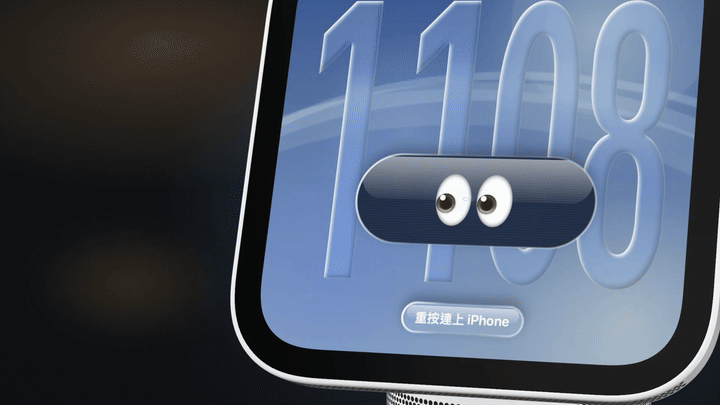
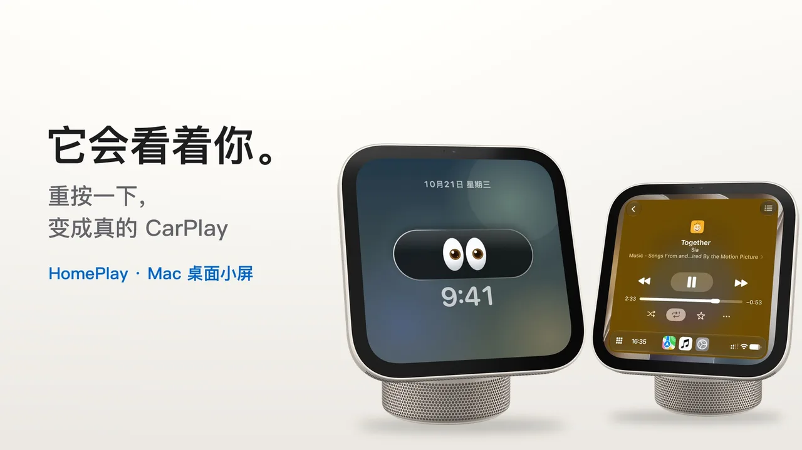
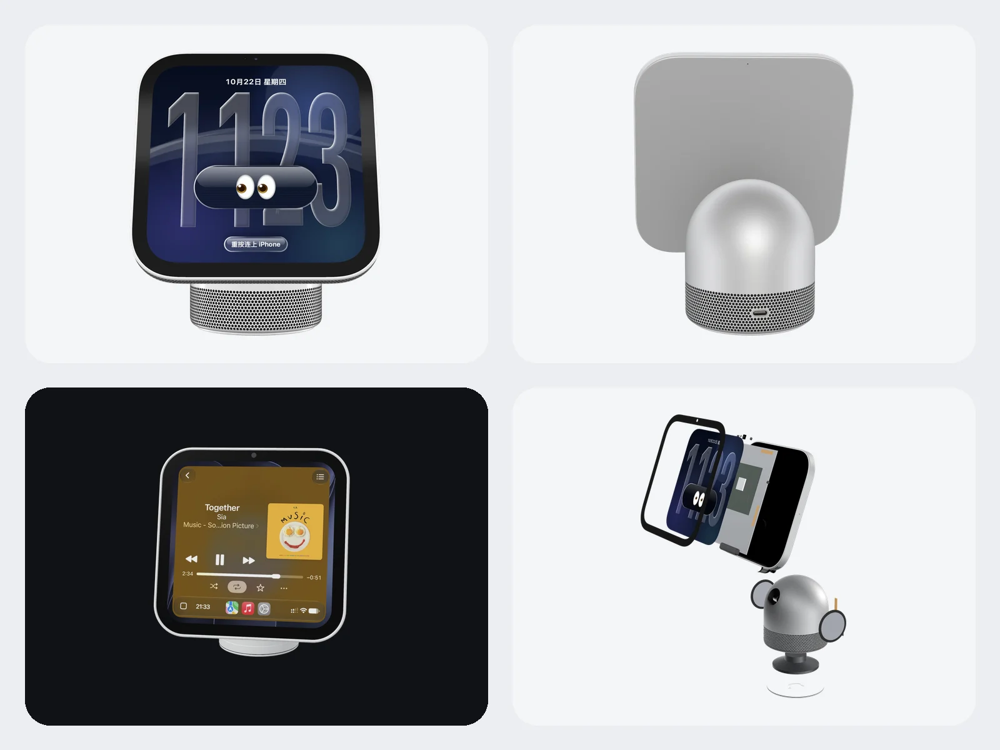
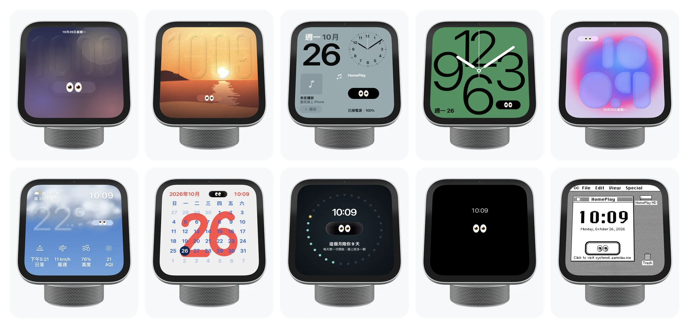
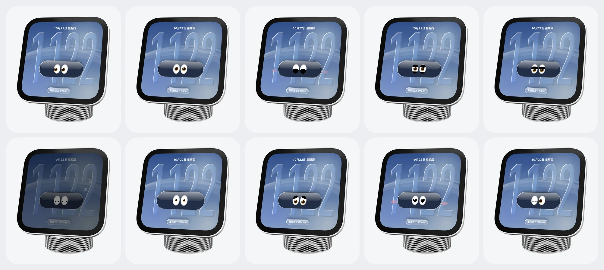

<div align="center">
  
  <h1>HomePlay</h1>
  <p><strong>它会看着你，并将 CarPlay 带到 Mac 上。</strong></p>
  <p>把 HomeView 做成 Mac 上的桌宠，让你在实体发售之前，率先体验 HomeView software 的交互。</p>
  <p><a href="README.en.md">English</a> · <a href="https://homeplay.aaronlau.me/zh-hans/">产品页面</a></p>
  <p>
    <a href="https://github.com/surfine/HomePlay/releases/latest"></a>
    
    
    
    
  </p>
</div>

> 个人实验项目，与 Apple Inc. 无关，也未经 Apple 认证或背书。CarPlay 与 HomeView 是 Apple Inc. 的商标，这里只用来说明兼容性。请自行评估使用风险。

## 它是什么

一台放在 Mac 桌面上的 HomeView。它有一双会看你的眼睛；用力按一下屏幕，它就变成 iPhone 的 CarPlay。

- **它会看着你。** 一双 👀，十种表情：你靠近，它好奇地看过来；指针停在它身上，它笑眯眯；深夜放着不管，它会打瞌睡。眼睛住在一颗胶囊里，胶囊跟着表盘的年代换材质：纯黑、黑透或 Liquid Glass。
- **10 款表盘。** 照 HomeView 官方的版式做：岛、照片、模块、Typograph（可换浮雕）、Flow、天气、日历、陪伴的痕迹、黑色，还有 System 6（三种版式）。大时间是系统的 Liquid Glass，字体和颜色可以像 iOS 27 锁定屏幕那样自己调。
- **用力按，就是 CarPlay。** 第一次插线，之后无线。iPhone 把真正的 CarPlay 画面和声音传到这台小屏幕，你在上面点，就像在车上点。按住 F5，直接和 iPhone 的 Siri 说话。
- **顺手的小工具。** 番茄钟、正在播放、电量、下一个日程；F7–F9 媒体键切歌，窗口可以置顶，当成 iPhone 曲库的迷你播放器。

<a href="https://www.bilibili.com/video/BV1rTnz6YEmM/"></a>

<p align="center"><sub>▶ <a href="https://www.bilibili.com/video/BV1rTnz6YEmM/">在 B 站看 44 秒演示</a> · 也可以在<a href="https://homeplay.aaronlau.me/zh-hans/#film">产品页面</a>直接播放</sub></p>



| 10 款表盘 | 十种表情 |
|:---:|:---:|
|  |  |

## 第一次用，三步

**需求：** macOS 14 及以上、Apple 芯片。

1. [**下载 HomePlay-macOS-arm64.zip**](https://github.com/surfine/HomePlay/releases/latest/download/HomePlay-macOS-arm64.zip)，解压，把 `HomePlay.app` 拖进「应用程序」，打开。
2. 用数据线把 iPhone 连到 Mac 一次，在 iPhone 上点「信任」和「配对」。
3. 用力按桌宠的屏幕，进入 CarPlay。之后拔掉线，它会自己用无线连接；第一次没切过去的话，在 iPhone 的控制中心把 Wi-Fi 关掉再打开一次。

App 有 Developer ID 签名并通过 Apple 公证，解压后直接打开。想核对下载文件：[`HomePlay-macOS-arm64.zip.sha256`](https://github.com/surfine/HomePlay/releases/latest/download/HomePlay-macOS-arm64.zip.sha256)，`shasum -a 256 -c HomePlay-macOS-arm64.zip.sha256`。

**目前只在这两台 iPhone 上测过：** iOS 15 的 iPhone SE（第 1 代，Lightning）和 iOS 27 的 iPhone 18 Pro（USB-C）。其他机型欢迎反馈。

## 怎么操作

| 想做什么 | 怎么做 |
|---|---|
| 进入／退出 CarPlay | 用力按屏幕（Force Click） |
| 和 Siri 说话 | 按住 F5 |
| 换表盘 | 滚动鼠标滚轮或按 ← →；长按屏幕看全部 |
| 转身体 | 在机身上拖动或双指滑动；双击回正 |
| 放大缩小 | 双指张合、⌥＋滚轮，或 ⌘+ ⌘− ⌘0 |
| 移动位置 | 三指拖移，或 ⌘ 拖动 |
| 拆开看看 | 双指轻点两下 |
| 设置 | 右键，或 ⌘, |

## 🧑🏻‍💻 开发者的话

> “👀”是我很喜欢的一个 emoji，可以用来表达兴奋和期待。唐老鸭是我最喜爱的卡通角色之一，一双灵动的大眼睛，呆萌呆萌的，可爱极了。
>
> 私以为在 AI 时代，拥有好奇心、释放想象力、发挥创造力、保持判断力和锻炼协同能力是至关重要的。希望 HomePlay 这只桌宠能带给大家一些乐趣。

## 1.0 的新东西

- **1.0.1：挂墙模式。** 右键 › 外观 › 挂墙：拿掉底座，只留屏幕，直立正对你；表盘、眼睛、CarPlay 都照常可用。
- **10 款表盘，每款都有眼睛。** 岛、照片、模块、Typograph（可换浮雕）、Flow、天气、日历、陪伴的痕迹、黑色、System 6（Finder、闹钟、关于三种版式，照 1988 年原样做）。胶囊跟着表盘的年代换材质：平面版式是纯黑，iOS 27 风格是黑透渐变，HomeView 本身是 Liquid Glass，System 6 是 1-bit 按钮。
- **10 种表情，各有各的轮廓。** 新增「在想」（等 CarPlay 连接时）和「不耐烦」（连点五下）；远远看也分得出来。
- **插线配对，之后无线。** 第一次插线就在屏幕上带你配对，配好立刻出画面；之后拔线，CarPlay 自己转到 Wi-Fi，画面和声音不断。重启后约 10–20 秒连回来。
- **按住 F5 的 Siri 球。** 说话时屏幕上浮出一颗彩色的光球，放开就缩回去。
- **字体与圆角更像官方。** 时间数字用 SF Pro 的可变字重、字宽与光学尺寸；胶囊、卡片和屏幕圆角保持同心。
- **更干净。** 换表盘、眨眼不再留残影；「字体与颜色」面板一次看得到全部选项；闲置更省电。

[完整 Release notes](https://github.com/surfine/HomePlay/releases/latest)

**下一步：HomePlay 2.0 Preview** —— 主画面、计时器与闹钟、食谱、家庭，以及自备 API 金钥（Anthropic／DeepSeek）的语音助手 ClioTalk。

## 隐私与权限

HomePlay 没有账号，也没有 telemetry。唯一会自己联网的是天气表盘：用大致位置向 Open-Meteo 查当地天气。权限按功能逐项申请：

| 权限 | 什么时候会问 | 拒绝后 |
|---|---|---|
| 相机 | 开启「跟随我」或「房间光线」时 | 桌宠本身照常使用 |
| 麦克风 | 第一次进入 CarPlay 通话／Siri 时 | CarPlay 画面与触控仍可用 |
| 蓝牙 | 第一次配对 iPhone 时 | 可用 USB 连接 |
| 局域网 | 接收 iPhone 的 CarPlay 画面时 | 无法使用 CarPlay |
| 位置（大致） | 天气表盘第一次出现时 | 天气表盘显示上次的城市或不显示天气 |
| 日历 | 开启日历表盘时 | 其他表盘照常使用 |
| Automation | 开启 Mac Now Playing 时 | 其他功能照常使用 |

相机画面只在本机处理，不存档、不上传。无线 CarPlay 需要 Wi-Fi 凭据时，由用户在菜单中填一次，存成本机 0600 文件；不读系统钥匙串。

## 从源代码编译

需要 macOS 14 以上与 Swift 6 工具链。

公开源代码快照**不包含** Apple 的 HomeView USDZ。请把 `apple-homeview.usdz` 放进 `Sources/homeplay-pet/Resources/`，否则机身不会加载。签名的 Release 已内置。

```sh
swift build -c release
B=.build/release

$B/homeplay-receiver --source auto --ssid '<Wi-Fi 名>' --port 8788
$B/homeplay-pet --endpoint ws://127.0.0.1:8788

$B/session-tests && $B/iap2-offline-tests
```

自己编译且要用 CarPlay 时，请准备 `identity.pk8` 与 `certificate.p7b`，用 `--identity-dir <目录>` 或环境变量 `HOMEPLAY_IDENTITY_DIR` 指定。只用桌宠、或使用 `--source window`／`h264` 时不需要身份。工具不会打印或上传身份内容。

| 目标 | 是什么 |
|---|---|
| `homeplay-pet` | 3D 桌宠（RealityKit + Apple USDZ），屏幕接接收器直播，触控回传 |
| `homeplay-receiver` | 接收器：`auto`（有线／无线）、`wireless`、`usb`、`window`、`h264` |
| `homeplay-verify` | 扮成客户端连接收器，解出一帧存 PNG |
| `session-tests` / `iap2-offline-tests` | 会话层与 iAP2 的离线测试 |

## 文档

| 文档 | 内容 |
|---|---|
| [无线连接与配对](docs/wireless.md) | iAP2 握手、可选的 Wi-Fi 凭据与疑难排解 |
| [性能与能耗](docs/performance.md) | 渲染循环、闲置行为与耗电测量 |
| [房间光线](docs/room-light.md) | 可选的相机光线估计 |
| [HomeView 研究](docs/homeview-study.md) | 比例与官方 USDZ 结构 |
| [CarPlay 实现笔记](docs/carplay-best-practices.md) | 接收器实现与边界情况 |

历史实拍与设计稿在 [`docs/evidence/`](docs/evidence/) 与 [`docs/design-drafts/`](docs/design-drafts/)；它们是历史资料，不是当前产品截图。

## 配件身份（只限源代码编译）

签名的 Release 已内置公开实验性配件身份，安装后即可使用，不需要另外准备文件。公开的源代码快照不包含这个身份。自己从源代码编译且要用 CarPlay 时，请自备 `identity.pk8` 与 `certificate.p7b`；来源与合法性由用户自行负责。工具不会打印身份内容。

## 致谢与授权

GPL-3.0-or-later，见 [`LICENSE`](LICENSE)。CarPlay 会话控制面参考 MacPlay 与 LIVI 的行为，以 Swift 重新实现；致谢与版权见 [`NOTICE`](NOTICE)。

HomePlay 是个人实验项目，与 Apple Inc. 无关。CarPlay 与 HomeView 是 Apple Inc. 的商标，这里只用来说明兼容性。

这个仓库是从私有开发仓库定期同步的精选快照，所以历史是一次一个同步提交。

## 回馈

请开 [issue](https://github.com/surfine/HomePlay/issues)。没有支持 SLA，但可复现的报告会读。
