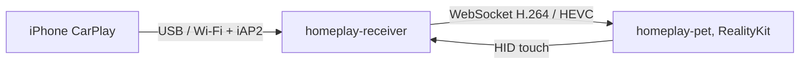

<div align="center">
  
  <h1>HomePlay</h1>
  <p><strong>桌上一台小屏幕，会看着你。Mac 上的 3D HomeView 桌宠，按下去是真的 CarPlay。</strong></p>
  <p><a href="README.en.md">English</a> · <a href="https://homeplay.aaronlau.me/zh-hans/">官网</a></p>
  <p>
    <a href="https://github.com/surfine/HomePlay/releases/latest"></a>
    
    
    
    
  </p>
</div>

> 个人实验项目，与 Apple Inc. 无关，也未经 Apple 认证或背书。CarPlay 与 HomeView 是 Apple Inc. 的商标，这里只用来说明兼容性。请自行评估使用风险。

## 安装

**需求：** macOS 14 以上、Apple Silicon。

[**下载 HomePlay-macOS-arm64.zip**](https://github.com/surfine/HomePlay/releases/latest/download/HomePlay-macOS-arm64.zip)（约 10.5 MB），然后：

1. 解压，把 `HomePlay.app` 拖进「应用程序」。
2. 打开。桌宠会带着时间与眼睛出现；不需要账号、配置文件或任何设置。
3. 第一次用 CarPlay：用 USB 线把 iPhone 连到 Mac 一次，在 iPhone 上点「信任」与「配对」。
4. 重按桌宠进入 CarPlay。配对稳定后拔线会自动切到无线。

Release 有 Developer ID 签名并通过 Apple 公证，解压后 Gatekeeper 会直接放行。对应的 checksum 是 [`HomePlay-macOS-arm64.zip.sha256`](https://github.com/surfine/HomePlay/releases/latest/download/HomePlay-macOS-arm64.zip.sha256)，可用 `shasum -a 256 -c HomePlay-macOS-arm64.zip.sha256` 验证。

## 0.5.0 的新东西

- **第一次公开发布**目前的 App。
- **同一双眼睛**：网站与设备都使用 Apple 👀 的琥珀虹膜语言；眨眼、睡着与单眼眨眼改成唐老鸭式下弯眼睑，保留白色眼白。
- **素材重拍**：三语实拍、新的分享卡，以及官网上一支无声、文字分离的 Mark View 式 hero film。

[完整 Release notes](https://github.com/surfine/HomePlay/releases/tag/v0.5.0)

## 实拍


| 五种外观 | 十种表情 |
|:---:|:---:|
|  |  |

## 特色

- **真的 CarPlay**：无线（蓝牙 iAP2 到 Wi-Fi）或有线 USB；H.264 与 HEVC；触控回传；声音走 Mac 扬声器；iPhone 的「正在播放」接到 Mac 系统 Now Playing 与控制中心。
- **插线一次，之后无线**：第一次用 USB 完成配对，稳定后自动切到无线；拔线不中断会话。同时接两台 iPhone 时，后到的那台取得唯一的 CarPlay 会话。
- **从官方产品出发**：Apple 官方 HomeView USDZ 几何与材质、五种机身外观、可拆九件、背面 USB-C 母座；RealityKit 实时渲染与 Quick Look 同级 IBL。
- **会看人的桌宠**：十种表情、九种表盘；拖动、双指滑、三指拖移、捏合、重按、长按。可选的「跟随我」与「房间光线」只在开启时使用相机。
- **安静、省电**：闲置后换成静态海报，ARView 离开画面；被遮住或屏幕休眠时停止渲染。没有通知、没有反馈、没有 telemetry。
- **零设置**：自动取得当前 Wi-Fi、自动匹配手机、插线与拔线自动切换；不读系统钥匙串，不弹管理员密码。
- **面向公开**：单一实例、VoiceOver 可按、英／简／繁、权限说明本地化、GPL 开源。

## 运作方式



## 手势

<details>
<summary>全部手势</summary>

| 动作 | 结果 |
|---|---|
| 拖动、双指滑 | 转身体 |
| 三指拖移、⌘ 拖动 | 移动位置（直播时拖边框） |
| 捏合、⌘+、⌘−、⌘0 | 放大缩小（⌘0 归位） |
| 重按 | 进入／退出 CarPlay |
| 长按屏幕 | 切换表盘 |
| 双击 | 角度回正 |
| 双指轻点两下 | 拆开／装回 |
| ⌘H | 隐藏桌宠（状态栏图标可再显示） |

</details>

## 隐私与权限

HomePlay 不连任何服务器，没有账号，也没有 telemetry。权限按功能逐项申请：

| 权限 | 什么时候会问 | 拒绝后 |
|---|---|---|
| 相机 | 开启「跟随我」或「房间光线」时 | 桌宠本身照常使用 |
| 麦克风 | 第一次进入 CarPlay 通话／Siri 时 | CarPlay 画面与触控仍可用 |
| 蓝牙 | 第一次配对 iPhone 时 | 可用 USB 连接 |
| 局域网 | 接收 iPhone 的 CarPlay 画面时 | 无法使用 CarPlay |
| 日历 | 开启日历表盘时 | 其他表盘照常使用 |
| Automation | 开启 Mac Now Playing 时 | 其他功能照常使用 |

相机画面只在本机处理，不存档、不上传。无线 CarPlay 需要 Wi-Fi 凭据时，由用户在菜单中填一次，存成本机 0600 文件；不读系统钥匙串。

## 从源代码编译

需要 macOS 14 以上与 Swift 6 工具链。

公开源代码快照**不包含** Apple 的 HomeView USDZ。请把 `apple-homeview.usdz` 放进 `Sources/homeplay-pet/Resources/`，否则机身不会加载。签名的 Release 已内置。

```sh
swift build -c release
B=.build/release

$B/homeplay-receiver --source auto --ssid '<Wi-Fi 名>' --port 8788
$B/homeplay-pet --endpoint ws://127.0.0.1:8788

$B/session-tests && $B/iap2-offline-tests
```

自己编译且要用 CarPlay 时，请准备 `identity.pk8` 与 `certificate.p7b`，用 `--identity-dir <目录>` 或环境变量 `HOMEPLAY_IDENTITY_DIR` 指定。只用桌宠、或使用 `--source window`／`h264` 时不需要身份。工具不会打印或上传身份内容。

| 目标 | 是什么 |
|---|---|
| `homeplay-pet` | 3D 桌宠（RealityKit + Apple USDZ），屏幕接接收器直播，触控回传 |
| `homeplay-receiver` | 接收器：`auto`（有线／无线）、`wireless`、`usb`、`window`、`h264` |
| `homeplay-verify` | 扮成客户端连接收器，解出一帧存 PNG |
| `session-tests` / `iap2-offline-tests` | 会话层与 iAP2 的离线测试 |

## 文档

| 文档 | 内容 |
|---|---|
| [无线连接与配对](docs/wireless.md) | iAP2 握手、可选的 Wi-Fi 凭据与疑难排解 |
| [性能与能耗](docs/performance.md) | 渲染循环、闲置行为与耗电测量 |
| [房间光线](docs/room-light.md) | 可选的相机光线估计 |
| [HomeView 研究](docs/homeview-study.md) | 比例与官方 USDZ 结构 |
| [CarPlay 实现笔记](docs/carplay-best-practices.md) | 接收器实现与边界情况 |

历史实拍与设计稿在 [`docs/evidence/`](docs/evidence/) 与 [`docs/design-drafts/`](docs/design-drafts/)；它们是历史资料，不是当前产品截图。

## 配件身份（只限源代码编译）

签名的 Release 已内置公开实验性配件身份，安装后即可使用，不需要另外准备文件。公开的源代码快照不包含这个身份。自己从源代码编译且要用 CarPlay 时，请自备 `identity.pk8` 与 `certificate.p7b`；来源与合法性由用户自行负责。工具不会打印身份内容。

## 致谢与授权

GPL-3.0-or-later，见 [`LICENSE`](LICENSE)。CarPlay 会话控制面参考 MacPlay 与 LIVI 的行为，以 Swift 重新实现；致谢与版权见 [`NOTICE`](NOTICE)。

HomePlay 是个人实验项目，与 Apple Inc. 无关。CarPlay 与 HomeView 是 Apple Inc. 的商标，这里只用来说明兼容性。

这个仓库是从私有开发仓库定期同步的精选快照，所以历史是一次一个同步提交。

## 回馈

请开 [issue](https://github.com/surfine/HomePlay/issues)。没有支持 SLA，但可复现的报告会读。
