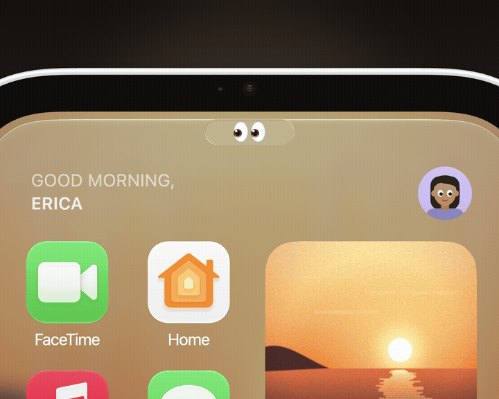

# HomePlay

**A pair of eyes is enough to say "I'm here."**

HomePlay is a HomeView that lives on the Mac desktop. Most of the time it watches, and stays quiet. Come closer and it lights up. A timer, a song, or a message shows up beside the eyes. You deal with it there, then go back to the window you left.

At night, it falls asleep before you do.

[简体中文](README.zh-Hans.md) · [Website](https://homeplay.aaronlau.me/en/2.0/) · [Film, shot before 1.0](https://www.bilibili.com/video/BV1rTnz6YEmM/) · [A history of widgets](https://homeplay.aaronlau.me/en/history/)



[Download 2.0 beta 6](https://github.com/surfine/HomePlay/releases/download/v2.0.0-beta.6/HomePlay-2.0-beta6-macOS-arm64.zip) · [Stable 1.0.6](https://github.com/surfine/HomePlay/releases/download/v1.0.6/HomePlay-macOS-arm64.zip)

macOS 14 or later, on Apple silicon. Both apps are Developer ID signed and notarized. 2.0 beta 6 is the preview, and it can have bugs. 1.0.6 is the stable build. GPL-3.0-or-later.

1.0 is the eyes, and CarPlay from an iPhone. 2.0 is the rest of HomeView: a Home Screen, faces, apps, and ClioTalk. This repository builds 1.0, the same app as 1.0.6. The 2.0 app is the beta download. The 2.0 source is not published here.

- [Put it on the desk](#put-it-on-the-desk)
- [The eyes are how you get home](#the-eyes-are-how-you-get-home)
- [What beta 6 puts on the glass](#what-beta-6-puts-on-the-glass)
- [ClioTalk asks first](#cliotalk-asks-first)
- [Privacy](#privacy)
- [Build 1.0 from source](#build-10-from-source)

## The change stays where you can see it

The Mac already has notifications and desktop widgets. A notification leaves. A widget sits behind whatever window is in front.

| | Where the change goes | Getting back to work |
|---|---|---|
| Notification | A banner, then it is gone | Open the app |
| Widget | The desktop, behind your windows | Click through to it |
| HomePlay | A screen that stays in view | Read it, act, return |

Microsoft Research tried that third row in 2001. JJ Cadiz, Gina Venolia, Gavin Jancke, and Anoop Gupta built Sideshow: a short summary at the edge of the screen. Point at it, and you can act without leaving your work. The CSCW 2002 paper is [Designing and Deploying an Information Awareness Interface](https://www.microsoft.com/en-us/research/publication/designing-and-deploying-an-information-awareness-interface-2/). The 2001 report is [Sideshow: Providing Peripheral Awareness of Important Information](https://www.microsoft.com/en-us/research/publication/sideshow-providing-peripheral-awareness-of-important-information/).

That Sideshow is a sidebar. HomePlay's SideShow is a paired iPad or phone. The machine on the desk is the screen that stays on.

Apple later moved widgets from Dashboard back to the desktop. That path is [A history of widgets](https://homeplay.aaronlau.me/en/history/).

## Put it on the desk

1. Unzip the download.
2. Move `HomePlay.app` into Applications and open it.
3. Set language, permissions, iPhone, and look when asked.

CarPlay pairs over a cable the first time. On the iPhone, tap Trust, then Pair. Unplug after the picture appears. The next connection uses Wi-Fi. If Wi-Fi does not connect, turn it off and on once in the iPhone Control Center.

Tested with an iPhone SE (1st generation, Lightning) on iOS 15, and an iPhone 18 Pro (USB-C) on iOS 27. For another phone, [open an issue](https://github.com/surfine/HomePlay/issues) with the model and the iOS version.

The film is 44 seconds, shot before 1.0, so a few faces look different now. [Watch it on Bilibili](https://www.bilibili.com/video/BV1rTnz6YEmM/). The 2.0 screens on the [website](https://homeplay.aaronlau.me/en/2.0/) were captured from the app, with demo data.

## The eyes are how you get home

Pull down on the eyes and you are on the Home Screen. Pull and hold for the app switcher. Press and hold the eyes, or hold F5, and you can talk to ClioTalk. What is happening now sits beside the eyes. Tap it to open. It shrinks back on its own.

| To | Do this |
|---|---|
| Go to the Home Screen | Pull down on the eyes |
| Open the app switcher | Pull down on the eyes and hold |
| Talk to ClioTalk | Press and hold the eyes, or hold F5 |
| Open Control Center | Swipe down from the top right |
| Switch CarPlay and Home | Press Space |
| Move in CarPlay | Press an arrow key, Tab, or Return |
| Change the face | Press and hold the screen |
| Open Settings | Right-click, or press ⌘, |

Drag the body to turn it. Double-click to face front. Pinch to resize, or hold Option and scroll. Drag with three fingers to move the window, or hold ⌘ and drag. Double-tap with two fingers to open the body.

On 1.0.6, press the screen firmly to open CarPlay. Hold F5 to talk to Siri on the iPhone.

After you go Home, CarPlay keeps playing. The eyes show what is playing.

A mouse, a trackpad, and a keyboard all work. On a touch Mac, and in Sidecar, a finger can tap, swipe, hold, and pinch. The eyes follow the finger. Use Xcode Simulator to test an interface. Use HomePlay when that interface should stay on the desk.

## What beta 6 puts on the glass

Hold an icon for half a second and the icons jiggle. Drop one on another and you get a folder. Widgets of the same size can stack, and the stack puts the right one on top for the time of day. Four looks, as on an iPhone: light, dark, clear, tinted. There is no Dock. The last page is the App Library.

The Home Screen uses Liquid Glass where macOS can draw it. On an older system, HomePlay draws the glass itself. Liquid Glass, on-device speech, and on-device models need macOS 26 or later.

Swipe down from the top right for Control Center: Now Playing, volume, brightness, a focus timer, Guest mode, the follow-me camera, and CarPlay. Volume is the Mac's output. Brightness dims only this screen. The focus timer is a Pomodoro.

Press and hold the screen to change the face: Photos, Modular, Typograph, Flow, Weather, Calendar, Days Together, Black, Island, and System 6 from 1988. On Island, pick 1988, 2002, or 2026. The frame around the eyes changes. Black-and-white pixels, then Aqua's blue jelly, then today's glass. The eyes stay the same.

A few of the apps, the way they behave:

- **Weather.** The sky moves. When it rains, rain falls on the screen. Forecasts come from Open-Meteo, from an approximate location.
- **Lyrics.** Sing fills the screen. Music and Podcasts can show synced lyrics from LRCLIB. That lookup sends the title, the artist, and the duration. You can turn it off.
- **A recipe.** Drag a page in, paste one, or copy one from the iPhone. It becomes steps in large type, readable from across the room. Tap a time in a step and a timer starts beside the eyes.
- **Games** opens games installed on this Mac.
- **Messages.** Reply by voice. The Mac turns speech into text. Before it sends, it reads the message aloud and waits. Reading needs Full Disk Access. Sending uses AppleScript. If delivery is not confirmed, HomePlay tells you and does not retry.
- **FaceTime.** Pick a person on the pet. FaceTime on the Mac places the call. You press call.
- **Home** shows a thermostat and cameras. Those need the HomePlay Home helper. This download does not include it. HomePlay explains why, then opens the Home app on the Mac.
- **Find My** shows this Mac on an approximate map. Other devices, and Play Sound, open Find My on the Mac.
- **Intercom.** Hold to talk, up to 30 seconds. Sound plays on the Mac, or on an AirPlay speaker you pick in Control Center. This is not HomePod Intercom.
- **YouTube** plays audio only. Other video plays picture and sound.

Page two also lists CarPlay, Timers, World Clock, Safari, Contacts, and the rest named in the [release notes](https://github.com/surfine/HomePlay/releases/tag/v2.0.0-beta.6). The full tour is on the [website](https://homeplay.aaronlau.me/en/2.0/).

Widgets from the Mac desktop can sit on this Home Screen, including widgets that came from an iPhone.

Each person has a Home Screen, a Look, playlists, and reminders. Switch from the avatar, or tell ClioTalk "I'm …".

AirDrop to the Mac raises a card. You can send a photo, a web page, or a recipe to the iPhone. While CarPlay is connected, the iPhone blocks AirDrop, so HomePlay sends that item to you in Messages. In Control Center, Receive AirDrop pauses CarPlay. When the file arrives, you are back where you were.

An idle iPhone or iPad can be a second HomeView. Turn it on under Settings, iPhone & iPad. Scan the code in Safari and type the one-time code. Traffic stays on the local network, and it is encrypted. A new device starts as a guest. This is off by default. The other device shows a web page, not an app. The Mac has to stay awake, and that device should not auto-lock.

## ClioTalk asks first

Press and hold the eyes, or hold F5, and speak. You can also swipe down from the top center. The Mac transcribes your speech. Only the text goes to the model.

1. It listens. The audio stays in memory. It is not saved.
2. It answers. An answer stays only after you tap Keep.
3. It asks first. A message, a reminder, or an event in your name is read aloud. Say yes, and it sends.

Store an Anthropic or DeepSeek key in the Keychain. You can also run a local model in LM Studio. On macOS 26 or later, you can use the on-device Apple Intelligence model. The cap starts at 5 US dollars a month. At the cap, ClioTalk stops. It does not keep spending.

## Who is in front of the Mac

Face recognition stays off until you turn on Follow Me and Recognise People. The Mac computes the face. HomePlay stores the feature numbers. It does not store a photo, and it does not write the face to a log.

Those numbers are general image features. Do not use them as a lock.

You can enroll six people. The first is the Mac's owner. Look at the camera, then turn your head a little to each side. A guest, and a face it does not know, sees the default Home Screen. Messages, photos, and calendars stay with the owner.

## Limits in beta 6

- Liquid Glass, on-device speech, and on-device models need macOS 26 or later.
- Cloud ClioTalk needs your own key.
- FaceTime and Find My finish in the Mac apps with those names.
- The paired iPhone or iPad shows a web page. The Mac has to stay awake.
- HomePlay draws its own interface. The CarPlay picture comes from your iPhone.

## Privacy

There is no account. HomePlay does not report how you use it. A feature contacts the network only after you turn that feature on.

- The 1.0 Weather face sends an approximate location to Open-Meteo.
- ClioTalk sends the transcript to the model you selected.
- Lyrics lookup sends the title, the artist, and the duration to LRCLIB. You can turn that lookup off.

HomePlay asks for each permission when the feature needs it.

| Permission | HomePlay asks when | If you refuse |
|---|---|---|
| Camera | You turn on Follow Me or Room Light | The pet still runs |
| Microphone | You start a CarPlay call or ClioTalk | CarPlay picture and touch still work |
| Bluetooth | You pair an iPhone for the first time | USB still works |
| Local Network | HomePlay receives the CarPlay picture | CarPlay cannot connect |
| Location, approximate | The Weather face opens the first time | Weather shows the last city, or nothing |
| Calendar | You turn on the Calendar face | The other faces still work |
| Automation | You turn on Mac Now Playing | The other features still work |
| Full Disk Access | HomePlay reads Messages | Messages stay unread |

The camera stays on this Mac. Frames are not saved and not uploaded. For wireless CarPlay, type the Wi-Fi name and password once in the menu. HomePlay stores them in a local file, mode 0600. It does not read them from the system Keychain. The ClioTalk key is the key you paste in. That key is stored in the Keychain.

## Build 1.0 from source

This repository builds 1.0: the desk pet and the CarPlay receiver. That build matches 1.0.6. Download the beta for the 2.0 app. The 2.0 source is not in this repository.

You need macOS 14 or later, and the Swift 6 toolchain. This source does not include Apple's HomeView USDZ. Put `apple-homeview.usdz` in `Sources/homeplay-pet/Resources/`. Without that file, the body does not load. The signed app already includes it.

The build links libopus and libspeexdsp. Those libraries decode CarPlay phone and Siri audio, and they cancel echo on the uplink. Install them with `brew install opus speexdsp`. `HOMEPLAY_OPUS_LIB` and `HOMEPLAY_SPEEX_LIB` can point at your own static libraries.

```sh
swift build -c release
B=.build/release

$B/homeplay-receiver --source auto --ssid '<Wi-Fi name>' --port 8788
$B/homeplay-pet --endpoint ws://127.0.0.1:8788

$B/session-tests && $B/iap2-offline-tests
```

CarPlay from a source build needs `identity.pk8` and `certificate.p7b`. Pass them with `--identity-dir <dir>`, or set `HOMEPLAY_IDENTITY_DIR`. The pet alone does not need an identity. `--source window` and `--source h264` do not need one either. The tools do not print or upload the identity.

| Target | What it builds |
|---|---|
| `homeplay-pet` | The 3D pet. RealityKit loads the Apple USDZ. The screen shows the receiver, and touch goes back. |
| `homeplay-receiver` | The receiver: `auto`, `wireless`, `usb`, `window`, `h264`. `auto` tries USB, then wireless. |
| `homeplay-verify` | Connects as a client and writes one frame to PNG. |
| `session-tests`, `iap2-offline-tests` | Offline tests for the session and for iAP2. |

Pass `--style` and `--face` to `homeplay-pet`. The eyes have ten expressions. Each expression has its own silhouette.

`--style` accepts:

- Island
- Photos
- Modular
- Typograph
- Flow
- Weather
- Calendar
- Days Together
- Black
- System 6

The signed app includes a public experimental accessory identity. CarPlay works after you install that app. This source snapshot does not include the identity. If you build CarPlay yourself, bring your own `identity.pk8` and `certificate.p7b`. You are responsible for their source and for whether you may use them.

| Document | What it covers |
|---|---|
| [Wireless pairing](docs/wireless.md) | The iAP2 handshake, the Wi-Fi credential, and what to check when pairing fails |
| [Performance](docs/performance.md) | The render loop, idle behavior, and power measurements |
| [Room light](docs/room-light.md) | The optional light estimate from the camera |
| [HomeView study](docs/homeview-study.md) | Proportions, and the structure of the official USDZ |
| [CarPlay notes](docs/carplay-best-practices.md) | How the receiver behaves, including edge cases |

[`docs/evidence/`](docs/evidence/) and [`docs/design-drafts/`](docs/design-drafts/) are earlier studies. They are not shots of the current app.

## License

GPL-3.0-or-later. See [`LICENSE`](LICENSE). The CarPlay session control was written again in Swift, following what MacPlay and LIVI do. Credits are in [`NOTICE`](NOTICE).

HomePlay is a personal project. It is not affiliated with, endorsed by, or certified by Apple Inc. CarPlay and HomeView are trademarks of Apple Inc.

Each publish of this repository is one snapshot commit. [Open an issue](https://github.com/surfine/HomePlay/issues) with the macOS version, the HomePlay version, and the steps that failed.

If a screen should stay on the desk, [star HomePlay](https://github.com/surfine/HomePlay). It helps the next person find it.
