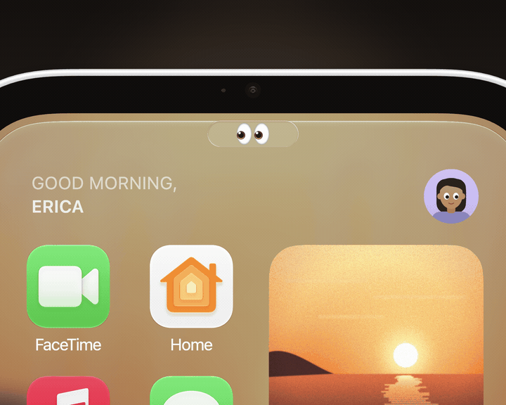

# HomePlay

放在 Mac 桌面上的 HomeView。它待在桌上，会看着你，并接上 iPhone 的 CarPlay。

[English](README.md)
[产品页面](https://homeplay.aaronlau.me/zh-hans/2.0/)



[下载 2.0 beta 6](https://github.com/surfine/HomePlay/releases/download/v2.0.0-beta.6/HomePlay-2.0-beta6-macOS-arm64.zip)
[下载 1.0.6](https://github.com/surfine/HomePlay/releases/download/v1.0.6/HomePlay-macOS-arm64.zip)

需要 macOS 14 及以上，Apple 芯片。两个 App 都有 Developer ID 签名，并通过 Apple 公证。2.0 beta 6 是预览版。1.0.6 是稳定版。GPL-3.0-or-later。

## 安装

1. 解压下载的 zip。
2. 把 `HomePlay.app` 拖进「应用程序」，然后打开。
3. 按提示设置语言、权限、iPhone 和外观。

CarPlay 第一次用线配对。在 iPhone 上点「信任」，再点「配对」。画面出来以后可以拔线。之后的连接走 Wi-Fi。如果 Wi-Fi 没连上，在 iPhone 的控制中心把 Wi-Fi 关一次，再打开。

已在 iPhone SE（第 1 代，Lightning，iOS 15）上测试。也在 iPhone 18 Pro（USB-C，iOS 27）上测试。其他机型请开 [issue](https://github.com/surfine/HomePlay/issues)，写上型号和 iOS 版本。

有一支 44 秒的片子，内容是桌宠和 CarPlay。[在 B 站看](https://www.bilibili.com/video/BV1rTnz6YEmM/)。2.0 的主屏幕在[产品页面](https://homeplay.aaronlau.me/zh-hans/2.0/)。

## 日常操作

| 要做的事 | 怎么做 |
|---|---|
| 回到主屏幕 | 从眼睛往下拉 |
| 打开 App 切换器 | 从眼睛往下拉，并按住 |
| 跟 ClioTalk 说话 | 按住眼睛，或按住 F5 |
| 在 CarPlay 和主屏幕之间切换 | 按空格键 |
| 在 CarPlay 里移动 | 按方向键、Tab 或 Return |
| 换表盘 | 按住屏幕 |
| 打开设置 | 右键，或按 ⌘, |

拖动机身来转动。双击，让它转回正面。双指张合来缩放。也可以按住 Option 再滚动。三指拖移来移动窗口。也可以按住 ⌘ 再拖动。双指轻点两下，打开机身。

在 1.0.6 里，用力按屏幕进入 CarPlay。按住 F5，跟 iPhone 上的 Siri 说话。

回到主屏幕以后，CarPlay 继续播放。正在播放的内容显示在眼睛旁边。

SideShow 把时钟、天气、正在播放和计时器显示在旧的 iPad 或手机上。在 HomePlay 里扫码完成配对。Mac 睡着时，那块屏幕留着最后的画面。

## beta 6 的主屏幕

完整列表在[发布说明](https://github.com/surfine/HomePlay/releases/tag/v2.0.0-beta.6)。

第二页有这些 App：

- CarPlay
- 天气
- 计时器
- 世界时钟
- Safari
- 食谱
- 跟唱
- 游戏
- 通讯录
- 查找

下一页是 App 资源库。这个主屏幕没有 Dock。

iPhone 上的 CarPlay App 列在「iPhone」下面。点一下，就在 CarPlay 里打开。可以在「设置 › 外观」里隐藏这一组。

- 跟唱把歌词铺满屏幕。
- 游戏打开这台 Mac 上已安装的游戏。
- 通讯录拨出 FaceTime。
- 家庭显示温控和摄像头。

温控和摄像头需要 HomePlay Home 小帮手。这个下载包里没有它。HomePlay 会说明原因，然后打开 Mac 上的「家庭」。

Mac 桌面上的小组件可以放到这个主屏幕上。从 iPhone 加过来的小组件也可以。

每个人有自己的主屏幕、外观、播放列表和提醒事项。从头像切换，也可以对 ClioTalk 说「我是…」。

AirDrop 到 Mac 时会弹出卡片。你可以把照片、网页或食谱发到 iPhone。CarPlay 连着的时候，iPhone 不允许 AirDrop。HomePlay 改用信息，把这份内容发给你自己。在控制中心接收 AirDrop 时，CarPlay 会暂停。文件到了以后，画面回到原来的地方。

## ClioTalk

按住眼睛，或按住 F5，然后说话。Mac 在本机把语音转成文字。只有文字会发给模型。

以你的名义发出信息、提醒或日程之前，ClioTalk 会先念出来。你说「好」，它才发送。

把 Anthropic 或 DeepSeek 的密钥放进钥匙串。也可以用 LM Studio 在本机跑模型。macOS 26 及以上可以用 Apple 智能的设备端模型。每月上限从 5 美元起。到了上限，ClioTalk 就停止。

声音只留在内存里。你点「留下」以后，回答才会保存。

## 谁在 Mac 前面

人脸识别默认关闭，要等你打开。计算在这台 Mac 上完成。HomePlay 保存的是面部特征数字。它不保存照片。

这些数字是通用图像特征。不要拿它当门锁。最多可以录入六个人。访客看到的是默认主屏幕。认不出的脸也看到这一屏。

## 一块留在视线里的屏幕

Mac 已经有桌面、窗口、通知和小组件。HomePlay 再加一块一直看得到的屏幕。你在这里看变化。你在这里操作。然后回到刚才的窗口。

2001 年，微软研究院做过这件事。JJ Cadiz、Gina Venolia、Gavin Jancke 和 Anoop Gupta 做了 Sideshow。一条短摘要留在屏幕边上。指上去，就可以处理，不用离开手头的工作。

CSCW 2002 论文：[Designing and Deploying an Information Awareness Interface](https://www.microsoft.com/en-us/research/publication/designing-and-deploying-an-information-awareness-interface-2/)。

2001 年报告：[Sideshow: Providing Peripheral Awareness of Important Information](https://www.microsoft.com/en-us/research/publication/sideshow-providing-peripheral-awareness-of-important-information/)。

论文里的 Sideshow 是一条侧边栏。HomePlay 的 SideShow 是配好的 iPad 或手机。这台桌上的小机器一直开着。

苹果把小组件从 Dashboard 放回了桌面。这段过程写在[小工具往事](https://homeplay.aaronlau.me/zh-hans/history/)。

用 Xcode 的 Simulator 测试界面。要让界面留在桌上，就用 HomePlay。鼠标、触控板和键盘都能用。在触控 Mac 上，以及在 Sidecar 里，手指可以点、滑、按住和捏合。眼睛会跟着手指。

## beta 6 的限制

- Liquid Glass、设备端语音和设备端模型需要 macOS 26 及以上。
- 云端的 ClioTalk 需要你自己的密钥。
- FaceTime 和「查找」由 Mac 上同名的 App 完成。对讲从 Mac 或隔空播放音箱播出。
- YouTube 只有声音。其他视频有画面，也有声音。
- 读取「信息」需要「完全磁盘访问权限」。发送用 AppleScript。如果没有确认送达，HomePlay 会告诉你，并且不会自动重发。
- 界面是 HomePlay 自己画的。CarPlay 的画面来自你的 iPhone。

## 隐私

没有账号。HomePlay 不上报你怎么使用。某个功能只有在你打开之后，才会联网。

- 1.0 的天气表盘把大致位置发给 Open-Meteo。
- ClioTalk 把转写后的文字发给你选的模型。
- 歌词查询把歌名、歌手和时长发给 LRCLIB。这项查询可以关掉。

HomePlay 在功能需要时才询问对应权限。

| 权限 | 何时询问 | 如果拒绝 |
|---|---|---|
| 相机 | 你打开「跟着我」或「房间光线」 | 桌宠继续运行 |
| 麦克风 | 你开始 CarPlay 通话或 ClioTalk | CarPlay 的画面和触控仍可用 |
| 蓝牙 | 你第一次配对 iPhone | USB 仍可用 |
| 局域网 | HomePlay 接收 CarPlay 画面 | CarPlay 无法连接 |
| 大致位置 | 天气表盘第一次打开 | 天气显示上次的城市，或什么都不显示 |
| 日历 | 你打开日历表盘 | 其他表盘仍可用 |
| 自动化 | 你打开 Mac 正在播放 | 其他功能仍可用 |
| 完全磁盘访问权限 | HomePlay 读取「信息」 | 「信息」读不到 |

相机只在这台 Mac 上工作。画面不保存，也不上传。无线 CarPlay 需要 Wi-Fi 名和密码时，在菜单里填一次。HomePlay 把它们存进一个本机文件，权限是 0600。它不从系统钥匙串读取这两项。ClioTalk 的密钥是你自己贴进去的。这把密钥存在钥匙串里。

## 从源代码编译 1.0

这个仓库编译的是 1.0：桌宠和 CarPlay 接收器。这个构建对应 1.0.6。2.0 的 App 请下载测试版。2.0 的源代码不在这个仓库里。

需要 macOS 14 及以上，以及 Swift 6 工具链。这份源代码不含 Apple 的 HomeView USDZ。把 `apple-homeview.usdz` 放进 `Sources/homeplay-pet/Resources/`。没有这个文件，机身不会加载。签名的 App 里已经带了这个文件。

编译会链接 libopus 和 libspeexdsp。它们用来解码 CarPlay 电话和 Siri 的音频，并消除上行回声。用 `brew install opus speexdsp` 安装。`HOMEPLAY_OPUS_LIB` 和 `HOMEPLAY_SPEEX_LIB` 可以指向你自己的静态库。

```sh
swift build -c release
B=.build/release

$B/homeplay-receiver --source auto --ssid '<Wi-Fi 名>' --port 8788
$B/homeplay-pet --endpoint ws://127.0.0.1:8788

$B/session-tests && $B/iap2-offline-tests
```

从源代码使用 CarPlay，需要 `identity.pk8` 和 `certificate.p7b`。用 `--identity-dir <目录>` 传入，或设置 `HOMEPLAY_IDENTITY_DIR`。只用桌宠时不需要身份。`--source window` 和 `--source h264` 也不需要。工具不会打印身份，也不会上传身份。

| 目标 | 编译出什么 |
|---|---|
| `homeplay-pet` | 3D 桌宠。RealityKit 加载 Apple 的 USDZ。屏幕显示接收器的画面，触控传回去。 |
| `homeplay-receiver` | 接收器：`auto`、`wireless`、`usb`、`window`、`h264`。`auto` 先试 USB，再试无线。 |
| `homeplay-verify` | 作为客户端连接，并把一帧写成 PNG。 |
| `session-tests`、`iap2-offline-tests` | 会话和 iAP2 的离线测试。 |

把 `--style` 和 `--face` 传给 `homeplay-pet`。眼睛有十种表情。每种表情的剪影都不一样。

`--style` 可以是：

- 岛
- 照片
- 模块
- Typograph
- Flow
- 天气
- 日历
- 陪伴的痕迹
- 黑色
- System 6

签名的 App 带有一份公开的实验性配件身份。装上那个 App 以后，CarPlay 就可以用。这份源代码快照不含那份身份。如果你自己编译 CarPlay，请自备 `identity.pk8` 和 `certificate.p7b`。来源是否正当、你是否可以使用，由你负责。

| 文档 | 内容 |
|---|---|
| [无线连接与配对](docs/wireless.md) | iAP2 握手、Wi-Fi 凭据，以及配对失败时要检查什么 |
| [性能与能耗](docs/performance.md) | 渲染循环、闲置行为，以及耗电测量 |
| [房间光线](docs/room-light.md) | 用相机做的可选光线估计 |
| [HomeView 研究](docs/homeview-study.md) | 比例，以及官方 USDZ 的结构 |
| [CarPlay 实现笔记](docs/carplay-best-practices.md) | 接收器怎么工作，包括边界情况 |

[`docs/evidence/`](docs/evidence/) 和 [`docs/design-drafts/`](docs/design-drafts/) 是更早的研究。它们不是当前 App 的截图。

## 授权

GPL-3.0-or-later。见 [`LICENSE`](LICENSE)。CarPlay 的会话控制用 Swift 重新实现，做法跟随 MacPlay 和 LIVI。致谢在 [`NOTICE`](NOTICE)。

HomePlay 是个人项目。它与 Apple Inc. 无关，未经 Apple 认证，也未经 Apple 背书。CarPlay 和 HomeView 是 Apple Inc. 的商标。

这个仓库的每一次发布都是一个快照提交。开 [issue](https://github.com/surfine/HomePlay/issues) 时，请写上 macOS 版本和 HomePlay 版本。也请写上失败的步骤。
