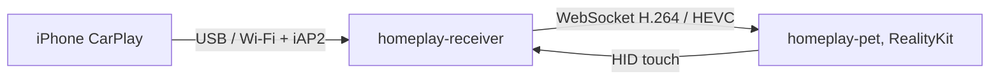

<div align="center">
  
  <h1>HomePlay</h1>
  <p><strong>桌上一台小螢幕，會看著你。Mac 上的 3D HomeView 桌寵，按下去是真的 CarPlay。</strong></p>
  <p><a href="README.md">English</a> · <a href="https://homeplay.aaronlau.me">官方網站</a></p>
  <p>
    <a href="https://github.com/surfine/HomePlay/releases/latest"></a>
    
    
    
    
  </p>
</div>

> 個人實驗專案，與 Apple Inc. 無關，也未經 Apple 認證或背書。CarPlay 與 HomeView 是 Apple Inc. 的商標，這裡只用來說明相容性。請自行評估使用風險。

## 安裝

**需求：** macOS 14 以上、Apple Silicon。

[**下載 HomePlay-macOS-arm64.zip**](https://github.com/surfine/HomePlay/releases/latest/download/HomePlay-macOS-arm64.zip)（約 10.5 MB），然後：

1. 解壓，把 `HomePlay.app` 拖進「應用程式」。
2. 打開。桌寵會帶著時間與眼睛出現；不需要帳號、設定檔或任何設定。
3. 第一次用 CarPlay：用 USB 線把 iPhone 連到 Mac 一次，在 iPhone 上點「信任」與「配對」。
4. 重按桌寵進入 CarPlay。配對穩定後拔線會自動切到無線。

Release 是 Developer ID 簽名並通過 Apple 公證，解壓後 Gatekeeper 會直接放行。對應的 checksum 是 [`HomePlay-macOS-arm64.zip.sha256`](https://github.com/surfine/HomePlay/releases/latest/download/HomePlay-macOS-arm64.zip.sha256)，可用 `shasum -a 256 -c HomePlay-macOS-arm64.zip.sha256` 驗證。

## 0.5.0 的新東西

- **第一次公開釋出**目前的 App。
- **同一雙眼睛**：網站與裝置都使用 Apple 👀 的琥珀虹膜語言；眨眼、睡著與單眼眨眼改成唐老鴨式下彎眼瞼，保留白色眼白。
- **素材重拍**：三語實拍、新的分享卡，以及官網上一支無聲、文字分離的 Mark View 式 hero film。

[完整 Release notes](https://github.com/surfine/HomePlay/releases/tag/v0.5.0)

## 實拍


| 五種外觀 | 十種表情 |
|:---:|:---:|
|  |  |

## 特色

- **真的 CarPlay**：無線（藍牙 iAP2 到 Wi-Fi）或有線 USB；H.264 與 HEVC；觸控回傳；聲音走 Mac 喇叭；iPhone 的「正在播放」接到 Mac 系統 Now Playing 與控制中心。
- **插線一次，之後無線**：第一次用 USB 完成配對，穩定後自動切到無線；拔線不中斷會話。同時接兩支 iPhone 時，後到的那支取得唯一的 CarPlay 會話。
- **從官方產品出發**：Apple 官方 HomeView USDZ 幾何與材質、五種機身外觀、可拆九件、背面 USB-C 母座；RealityKit 實時渲染與 Quick Look 同級 IBL。
- **會看人的桌寵**：十種表情、九種錶面；拖動、兩指滑、三指拖移、捏合、重按、長按。可選的「跟隨我」與「房間光線」只在開啟時使用相機。
- **安靜、省電**：閒置後換成靜態海報，ARView 離開畫面；被遮住或螢幕休眠時停止渲染。沒有通知、沒有回饋、沒有 telemetry。
- **零設定**：自動取得目前 Wi-Fi、自動匹配手機、插線與拔線自動切換；不讀系統鑰匙圈，不彈管理員密碼。
- **面向公開**：單一實例、VoiceOver 可按、英／簡／繁、權限說明本地化、GPL 開源。

## 運作方式



## 手勢

<details>
<summary>全部手勢</summary>

| 動作 | 結果 |
|---|---|
| 拖動、兩指滑 | 轉身體 |
| 三指拖移、⌘ 拖動 | 搬位置（直播時拖邊框） |
| 捏合、⌘+、⌘−、⌘0 | 放大縮小（⌘0 歸位） |
| 重按 | 進入／退出 CarPlay |
| 長按螢幕 | 切換錶面 |
| 雙擊 | 角度回正 |
| 雙指輕點兩下 | 拆開／組回 |
| ⌘H | 隱藏桌寵（狀態欄圖示可再顯示） |

</details>

## 隱私與權限

HomePlay 不連任何伺服器，沒有帳號，也沒有 telemetry。權限按功能逐項申請：

| 權限 | 什麼時候會問 | 拒絕後 |
|---|---|---|
| 相機 | 開啟「跟隨我」或「房間光線」時 | 桌寵本身照常使用 |
| 麥克風 | 第一次進入 CarPlay 通話／Siri 時 | CarPlay 畫面與觸控仍可用 |
| 藍牙 | 第一次配對 iPhone 時 | 可用 USB 連線 |
| 區域網路 | 接收 iPhone 的 CarPlay 畫面時 | 無法使用 CarPlay |
| 行事曆 | 開啟行事曆錶面時 | 其他錶面照常使用 |
| Automation | 開啟 Mac Now Playing 時 | 其他功能照常使用 |

相機畫面只在本機處理，不存檔、不上傳。無線 CarPlay 需要 Wi-Fi 憑據時，由使用者在選單中填一次，存成本機 0600 檔案；不讀系統鑰匙圈。

## 從原始碼編譯

需要 macOS 14 以上與 Swift 6 工具鏈。

公開原始碼快照**不包含** Apple 的 HomeView USDZ。請把 `apple-homeview.usdz` 放進 `Sources/homeplay-pet/Resources/`，否則機身不會載入。簽名的 Release 已內建。

```sh
swift build -c release
B=.build/release

$B/homeplay-receiver --source auto --ssid '<Wi-Fi 名>' --port 8788
$B/homeplay-pet --endpoint ws://127.0.0.1:8788

$B/session-tests && $B/iap2-offline-tests
```

自己編譯且要用 CarPlay 時，請準備 `identity.pk8` 與 `certificate.p7b`，用 `--identity-dir <目錄>` 或環境變數 `HOMEPLAY_IDENTITY_DIR` 指定。只用桌寵、或使用 `--source window`／`h264` 時不需要身份。工具不會打印或上傳身份內容。

| 目標 | 是什麼 |
|---|---|
| `homeplay-pet` | 3D 桌寵（RealityKit + Apple USDZ），螢幕接接收器直播，觸控回傳 |
| `homeplay-receiver` | 接收器：`auto`（有線／無線）、`wireless`、`usb`、`window`、`h264` |
| `homeplay-verify` | 扮成客戶端連接收器，解出一幀存 PNG |
| `session-tests` / `iap2-offline-tests` | 會話層與 iAP2 的離線測試 |

## 文件

| 文件 | 內容 |
|---|---|
| [無線連線與配對](docs/wireless.md) | iAP2 握手、選填的 Wi-Fi 憑據與疑難排解 |
| [效能與能耗](docs/performance.md) | 渲染迴圈、閒置行為與耗電量測 |
| [房間光線](docs/room-light.md) | 選填的相機光線估計 |
| [HomeView 研究](docs/homeview-study.md) | 比例與官方 USDZ 結構 |
| [CarPlay 實作筆記](docs/carplay-best-practices.md) | 接收器實作與邊界情況 |

歷史實拍與設計稿在 [`docs/evidence/`](docs/evidence/) 與 [`docs/design-drafts/`](docs/design-drafts/)；它們是歷史資料，不是目前產品截圖。

## 配件身份（只限原始碼編譯）

簽名的 Release 已內建公開實驗性配件身份，安裝後即可使用，不需要另外準備檔案。公開的原始碼快照不包含這個身份。自己從原始碼編譯且要用 CarPlay 時，請自備 `identity.pk8` 與 `certificate.p7b`；來源與合法性由使用者自行負責。工具不會打印身份內容。

## 致謝與授權

GPL-3.0-or-later，見 [`LICENSE`](LICENSE)。CarPlay 會話控制面參考 MacPlay 與 LIVI 的行為，以 Swift 重新實作；致謝與版權見 [`NOTICE`](NOTICE)。

HomePlay 是個人實驗專案，與 Apple Inc. 無關。CarPlay 與 HomeView 是 Apple Inc. 的商標，這裡只用來說明相容性。

這個倉庫是從私有開發倉庫定期同步的精選快照，所以歷史是一次一個同步提交。

## 回饋

請開 [issue](https://github.com/surfine/HomePlay/issues)。沒有支援 SLA，但可重現的報告會讀。
